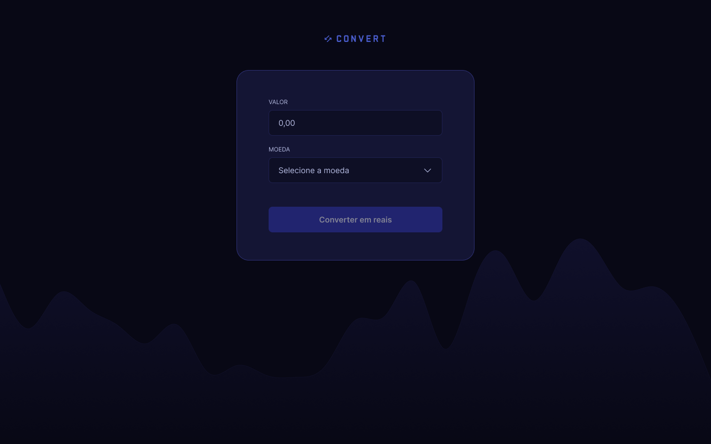

# Convert - Conversor de Moedas

Aplicação web desenvolvida durante meus estudos de **Desenvolvimento Front-end**, com foco na utilização de JavaScript para criação de interfaces interativas e manipulação do DOM.

O projeto permite converter valores de dólar americano (USD), euro (EUR) e libra esterlina (GBP) para real brasileiro (BRL), utilizando cotações fixas para fins educacionais.

Desenvolvido com acompanhamento de aulas práticas, o projeto recebeu melhorias na organização dos arquivos, responsividade, acessibilidade e validação dos dados.

## 📸 Prévia do projeto



## 🛠️ Tecnologias utilizadas

- **HTML5:** estruturação da página e criação do formulário.
- **CSS3:** estilização, Flexbox, responsividade e organização modular dos estilos.
- **JavaScript:** manipulação do DOM, eventos, validação de dados e conversão de valores.
- **Git:** controle de versão do projeto.
- **GitHub Pages:** publicação da aplicação na web.

## ⚙️ Características do projeto

- Conversão de dólar americano, euro e libra esterlina para reais.
- Interface interativa utilizando JavaScript.
- Validação de valores informados pelo usuário.
- Formatação monetária no padrão brasileiro.
- Exibição da cotação utilizada e do resultado da conversão.
- Layout responsivo desenvolvido com abordagem Mobile First.
- Organização dos estilos em arquivos CSS separados.
- Aplicação de boas práticas de acessibilidade.
- Navegação por teclado com indicadores visuais de foco.
- Tratamento de erros durante a conversão.

## 📚 Aprendizados

Durante o desenvolvimento do Convert, pude praticar conceitos fundamentais de HTML, CSS e, principalmente, JavaScript, compreendendo melhor como criar interações entre o usuário e a interface.

### HTML e estruturação

- Construção e organização de formulários.
- Utilização de elementos semânticos.
- Associação de labels aos campos do formulário.
- Aplicação de atributos para melhorar a acessibilidade.
- Estruturação de uma página para receber interações com JavaScript.

### CSS e responsividade

- Utilização de Flexbox para alinhamento dos elementos.
- Aplicação de variáveis CSS para padronização visual.
- Organização dos estilos em arquivos separados.
- Desenvolvimento responsivo com Mobile First.
- Utilização de Media Queries.
- Implementação de estados de foco e interação.
- Adaptação da interface para diferentes tamanhos de tela.

### JavaScript e interatividade

- Seleção de elementos HTML com `querySelector()` e `getElementById()`.
- Manipulação do DOM com `textContent` e `classList`.
- Captura de eventos com `addEventListener()`.
- Utilização de funções e parâmetros.
- Aplicação de estruturas condicionais com `switch`.
- Validação e tratamento de entradas do usuário.
- Utilização de expressões regulares.
- Conversão de tipos com `Number()`.
- Formatação de moedas com `toLocaleString()`.
- Tratamento de erros com `try...catch`.

### Boas práticas

- Separação entre estrutura, estilo e comportamento.
- Organização de pastas e arquivos.
- Utilização de nomes descritivos para variáveis e funções.
- Reutilização de funções para evitar repetição de código.
- Aplicação de conceitos básicos de acessibilidade e SEO.
- Versionamento do projeto com Git e GitHub.

## 📂 Estrutura do projeto

```text
convert-currency/
├── css/
│   ├── button.css
│   ├── footer.css
│   ├── forms.css
│   ├── global.css
│   ├── main.css
│   └── style.css
├── img/
│   ├── bg.png
│   ├── check.svg
│   ├── chevron-down.svg
│   ├── logo.svg
│   └── preview-convert.png
├── index.html
├── scripts.js
└── README.md
```

## 💻 Como executar localmente

O projeto utiliza HTML, CSS e JavaScript puro, sem necessidade de instalação de dependências.

**1. Clone o repositório:**

```bash
git clone https://github.com/lpwesley/convert-currency.git
```

**2. Acesse a pasta do projeto:**

```bash
cd convert-currency
```

**3. Execute o projeto:**

Abra o arquivo `index.html` diretamente no navegador ou utilize a extensão **Live Server** no Visual Studio Code.

## 📝 Observações

Este projeto foi desenvolvido para fins educacionais, utilizando cotações fixas definidas no JavaScript.

Os valores apresentados não representam necessariamente as taxas de câmbio atuais e não devem ser utilizados para operações financeiras reais.

A implementação inicial foi realizada com acompanhamento de aulas, seguida de melhorias voltadas à organização, responsividade, acessibilidade e manutenção do código.

## 🎓 Créditos

Projeto desenvolvido com base em aulas práticas de desenvolvimento Front-end, com adaptações e melhorias realizadas durante meus estudos.

---

Desenvolvido por **Wesley Lauwer**.

[GitHub](https://github.com/lpwesley)
